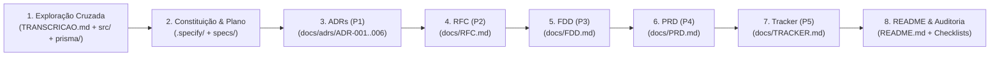

# Pacote de Design Docs com IA — Sistema de Webhooks de Notificação de Pedidos (OMS)

> 📌 **Referência ao Enunciado Original**: O enunciado completo do desafio foi preservado em [`specs/001-webhook-design-docs/enunciado-original.md`](./specs/001-webhook-design-docs/enunciado-original.md).

---

## Sobre o Desafio

Este projeto consiste na transformação da transcrição bruta de uma reunião técnica de 55 minutos (`TRANSCRICAO.md`) e da base de código existente de um **Order Management System (OMS)** (Node.js, TypeScript, Express, MySQL/Prisma, Zod e Pino) em um pacote completo, coeso e diretamente acionável de documentação de engenharia para uma nova feature: o **Sistema de Outbound Webhooks de Notificação de Pedidos**.

O desafio central não é apenas resumir uma conversa, mas atuar como **maestro da Inteligência Artificial** aplicando separação estrita de alturas documentais — **ADRs** (*Por que decidimos exatamente assim?*), **RFC** (*Como pretendemos resolver e o que segue em aberto?*), **FDD** (*Como construir em detalhe e integrar ao código real?*), **PRD** (*Por que construir, para quem e com quais metas?*) e **Tracker** (*De onde veio cada afirmação?*) — filtrando com rigor o que foi descartado ou adiado na reunião e garantindo **zero alucinação** sem tocar em nenhuma linha de código da aplicação (`src/`, `prisma/`, `tests/`).

---

## Ferramentas de IA Utilizadas

| Ferramenta / Agente | Papel Desempenhado no Processo |
| :--- | :--- |
| **Google Antigravity (IDE Agêntica com Gemini)** | Ambiente principal de orquestração *human-in-the-loop*, leitura contextualizada do repositório (`src/**`, `prisma/schema.prisma`, `tests/**`), cruzamento linha a linha com `TRANSCRICAO.md`, geração dirigida dos artefatos Markdown e execução de scripts de auditoria. |
| **GitHub Spec Kit (`speckit-*` Skills)** | Framework de engenharia de especificação utilizado para estruturar o fluxo em etapas verificáveis (`constitution` $\rightarrow$ `specify` $\rightarrow$ `plan` $\rightarrow$ `tasks` $\rightarrow$ `analyze` $\rightarrow$ `implement`), estabelecendo portões de qualidade antes da redação final dos documentos em `docs/`. |

---

## Workflow Adotado

Para evitar documentos genéricos, redundantes ou contaminados por ideias descartadas na reunião, o trabalho foi organizado em **8 etapas sequenciais** seguindo a pirâmide de dependência estrutural recomendada (`ADRs → RFC → FDD → PRD → Tracker → README`):



1. **Contextualização e Mapeamento Cruzado (`research.md`)**: Leitura integral das 324 linhas de `TRANSCRICAO.md` em conjunto com a árvore real de `src/` e `prisma/schema.prisma`, classificando cada fala em: *(a)* decisão fechada, *(b)* requisito funcional/não funcional, *(c)* alternativa descartada, *(d)* questão em aberto/fora de escopo e *(e)* ponto de integração no código existente.
2. **Governança Anti-Alucinação (`constitution.md`)**: Definição formal das regras inegociáveis do projeto (rastreabilidade `[hh:mm] Nome` ou arquivo real, imutabilidade de `src/`/`prisma/`/`tests/`/`TRANSCRICAO.md` e separação de alturas entre documentos).
3. **ADRs Primeiro (`docs/adrs/ADR-001` a `ADR-006`)**: Formalização das 6 decisões arquiteturais fundamentais em formato MADR antes de escrever os documentos maiores, fixando o vocabulário técnico e os trade-offs.
4. **RFC (`docs/RFC.md`)**: Consolidação da proposta técnica em nível arquitetural conciso (2–4 páginas), reunindo as 6 alternativas descartadas na reunião com seus trade-offs, as 5 questões deixadas em aberto e links diretos para os 6 ADRs.
5. **FDD (`docs/FDD.md`)**: Especificação profunda de construção contendo modelagem de dados Prisma, diagramas de sequência (outbox, worker 2s, retry `1m/5m/30m/2h/12h` e DLQ), 7 contratos de endpoints REST + contrato do POST outbound, matriz de 10 erros `WEBHOOK_*`, resiliência, observabilidade (métricas, logs Pino e tracing via `X-Event-Id`) e a seção obrigatória **"Integração com o sistema existente"** detalhando 12 arquivos reais do repositório.
6. **PRD (`docs/PRD.md`)**: Consolidação da visão de produto e negócio (dor de polling em `GET /api/v1/orders` dos clientes Atlas Comercial, MaxDistribuição e Nova Cargo, risco de churn até o fim do trimestre, 3 metas quantitativas, 5 exclusões explícitas de escopo, 12 requisitos funcionais, 8 não funcionais e 5 riscos com probabilidade, impacto e mitigação).
7. **Tracker (`docs/TRACKER.md`)**: Construção e validação automatizada de uma matriz com **124 itens rastreados** (100% dos itens numerados nos documentos, sendo 90,3% `TRANSCRICAO` e 12 linhas `CODIGO`).
8. **README do Processo e Revisão Final**: Documentação transparente da jornada com IA e validação executável de todos os critérios de aceite.

---

## Prompts Customizados

Abaixo estão 3 dos principais prompts dirigidos utilizados durante a orquestração para garantir precisão técnica, filtragem de escopo e rastreabilidade:

### Prompt 1 — Mapeamento Cruzado e Filtragem de Escopo (`TRANSCRICAO.md` $\times$ Código Base)

```markdown
Atue como Staff Software Engineer analisando o repositório do Order Management System (OMS) em modo estritamente read-only.
Leia integralmente `TRANSCRICAO.md`, `prisma/schema.prisma` e todos os arquivos em `src/`.

Sua tarefa é produzir um mapeamento estruturado e sem ambiguidades separando:
1. As 6 decisões arquiteturais fechadas na reunião, incluindo os detalhes confirmados nos minutos finais da call ([09:50] a [09:53], como ID UUID na outbox e snapshot JSON pré-renderizado na inserção).
2. Tabela de filtragem rigorosa do que NÃO entra como requisito ativo:
   - Ideias explicitamente descartadas como alternativas técnicas (com o timestamp `[hh:mm] Nome` e o trade-off que levou ao descarte);
   - Funcionalidades explicitamente excluídas do escopo ou adiadas para fases futuras (inbound webhooks, e-mail após falhas seguidas, dashboard visual, expurgo >30 dias, rate limiting de saída, multi-worker com particionamento, endurecimento de RBAC no CRUD).
3. Mapeamento exato dos arquivos reais de `src/` e `prisma/` onde o módulo de webhooks se integrará (ex.: linha exata da transação `this.prisma.$transaction` em `OrderService.changeStatus`, uso de `AppError` e `http-errors.ts`, `errorMiddleware`, `authenticate`/`requireRole('ADMIN')`, `validate` com Zod, `paginated` e `logger` Pino).
Proibido inventar qualquer informação sem origem verificável em `[hh:mm] Nome` ou caminho real do repositório.
```

### Prompt 2 — Geração do FDD Acionável com Fronteira de Abstração Estrita

```markdown
Com base nos 6 ADRs (`docs/adrs/ADR-001` a `ADR-006`) e no `docs/RFC.md`, elabore o Feature Design Document em `docs/FDD.md`.
Respeite a altura de Implementação ("Como construir, em detalhe?"):
- Especifique os 4 modelos Prisma propostos (`WebhookEndpoint`, `WebhookOutbox`, `WebhookDelivery`, `WebhookDeadLetter`) usando `String @id @default(uuid()) @db.Char(36)` conforme `prisma/schema.prisma` e `[09:51] Larissa`.
- Detalhe os 4 fluxos operacionais: (1) criação atômica via função pura `publishWebhookEvent(tx, order, fromStatus, toStatus)` com filtro de status na inserção e validação de teto de 64KB; (2) polling a cada 2s em `src/worker.ts`; (3) curva de retry exponencial (5 tentativas: 1m, 5m, 30m, 2h, 12h) com timeout HTTP de 10s; (4) movimentação para `webhook_dead_letter` e replay manual por `ADMIN`.
- Documente todos os contratos públicos HTTP (`/api/v1/webhooks` CRUD, `rotate-secret`, `deliveries`, `/api/v1/admin/webhooks/dead-letter/:id/replay` e o contrato do POST outbound com headers `X-Event-Id`, `X-Signature`, `X-Timestamp`, `X-Webhook-Id` e payload sem `items`).
- Construa a Matriz de Erros Previstos usando exclusivamente códigos com prefixo `WEBHOOK_*` mapeados às classes de `src/shared/errors/http-errors.ts`.
- Na seção obrigatória "Integração com o sistema existente", referencie apenas caminhos de arquivos reais existentes no repositório e mostre o snippet de integração em `src/modules/orders/order.service.ts`.
```

### Prompt 3 — Auditoria Anti-Alucinação e Construção do Tracker (`docs/TRACKER.md`)

```markdown
Varra todos os itens numerados em `docs/adrs/ADR-001..006-*.md`, `docs/RFC.md`, `docs/FDD.md` e `docs/PRD.md` e gere `docs/TRACKER.md` no formato obrigatório:
`| ID | Documento | Tipo | Conteúdo (resumo) | Fonte | Localização |`

Regras de validação:
1. Cobertura de 100% dos itens identificáveis (superando o mínimo de 80%).
2. Cada linha com `Fonte = TRANSCRICAO` deve conter um `[hh:mm] Nome` que exista literalmente em `TRANSCRICAO.md` (mínimo de 70% das linhas totais).
3. Cada linha com `Fonte = CODIGO` deve conter um caminho de arquivo real que exista em `src/` ou `prisma/` (mínimo de 5 linhas).
4. Caso qualquer afirmação nos documentos não possua localização exata verificável na transcrição ou no código, sinalize imediatamente para remoção ou correção.
```

---

## Iterações e Ajustes

O processo completo passou por **4 iterações principais** de geração, revisão crítica humana e refinamento até atingir o estado final:

1. **Iteração 1 — Captura das Decisões do "Pós-Reunião" (`[09:50]` a `[09:53]`) e Regra do `customerId` fora do JWT**:
   - *Problema identificado*: Na primeira leitura sumarizada, havia o risco de assumir que o `customerId` viria implícito do token JWT (como Marcos sugeriu inicialmente em `[09:31] Marcos`) e de omitir as definições tomadas após a saída de Marcos e Sofia da call (`[09:50]`).
   - *Correção aplicada*: Refinamos o mapeamento para refletir a correção imediata de Bruno e Larissa em `[09:32]` (o JWT atual em `src/middlewares/auth.middleware.ts` autentica o usuário operador/admin com `{ id, email, role }`, portanto `customerId` deve ser passado explicitamente no body/query) e incorporamos como regras obrigatórias do `ADR-001` e do `FDD` os dois pontos fechados entre `[09:51]` e `[09:52]`: chave primária `UUID` na outbox e gravação do **snapshot JSON já renderizado no momento da inserção** (sem a lista de `items` do pedido conforme `[09:43] Diego`).
2. **Iteração 2 — Corte de Sobreposição entre `RFC.md` e `FDD.md` (Separação de Alturas)**:
   - *Problema identificado*: O rascunho inicial da proposta técnica no RFC tendia a antecipar schemas completos de tabelas e exemplos extensos de payloads JSON de request/response, duplicando o conteúdo do FDD.
   - *Correção aplicada*: Enxugamos o `docs/RFC.md` para operar estritamente na altura de **Arquitetura** (visão sistêmica em diagrama Mermaid, resumo dos 6 pilares, tabela de 6 alternativas descartadas com trade-offs, 5 questões em aberto e links para os 6 ADRs), delegando toda a especificação de colunas Prisma, contratos JSON e códigos `WEBHOOK_*` exclusivamente para o `docs/FDD.md`.
3. **Iteração 3 — Distinção Rigorosa entre Arquivos Existentes e Arquivos Propostos na Validação de Caminhos**:
   - *Problema identificado*: Na reunião, Larissa e Bruno mencionam a criação futura de `src/worker.ts` (`[09:11] Larissa`) e da pasta `src/modules/webhooks/` (`[09:27] Bruno`), que naturalmente ainda não existem no repositório (já que o código é imutável neste desafio). Se listados como arquivos existentes na tabela de rastreabilidade `Fonte = CODIGO`, quebrariam a regra de que 100% dos arquivos referenciados como código existente devem existir no repositório.
   - *Correção aplicada*: Padronizamos todas as 12 referências `Fonte = CODIGO` no `docs/TRACKER.md` e na seção 10 do `docs/FDD.md` para apontarem exclusivamente para os arquivos reais existentes (`prisma/schema.prisma`, `src/modules/orders/order.service.ts`, `src/modules/orders/order.status.ts`, `src/shared/errors/app-error.ts`, `src/shared/errors/http-errors.ts`, `src/middlewares/error.middleware.ts`, `src/middlewares/auth.middleware.ts`, `src/middlewares/validate.middleware.ts`, `src/shared/logger/index.ts`, `src/shared/http/response.ts`, `src/routes/index.ts`, `src/app.ts`, `src/server.ts`, `src/config/database.ts`), validando-os via script automatizado.
4. **Iteração 4 — Auditoria Automatizada de Timestamps no `docs/TRACKER.md`**:
   - *Problema identificado*: Em tabelas extensas de rastreabilidade (124 linhas), referências combinadas (como `[09:21] / [09:22] Sofia`) dificultam a verificação mecânica contra `TRANSCRICAO.md`.
   - *Correção aplicada*: Normalizamos todas as 112 entradas `TRANSCRICAO` do `docs/TRACKER.md` para o formato canônico exato `[hh:mm] Nome` e executamos um script `awk` + `grep -Fq` confirmando que 100% dos timestamps e nomes de falantes existem literalmente em `TRANSCRICAO.md`.

---

## Como Navegar a Entrega

### Estrutura dos Arquivos Entregues

```text
.
├── README.md                                                        # Este documento (jornada e processo com IA)
├── TRANSCRICAO.md                                                   # [Fonte Primária Imutável] Transcrição da reunião
├── docs/
│   ├── adrs/                                                        # [Altura: Decisão Pontual] 6 ADRs no padrão MADR
│   │   ├── README.md                                                # Índice navegável dos ADRs
│   │   ├── ADR-001-outbox-no-mysql.md                               # Outbox transacional no MySQL + snapshot JSON + UUID
│   │   ├── ADR-002-worker-separado-em-polling.md                    # Worker em processo separado + polling de 2s
│   │   ├── ADR-003-politica-de-retry-backoff-e-dlq.md               # 5 retries (1m/5m/30m/2h/12h), timeout 10s e DLQ
│   │   ├── ADR-004-autenticacao-hmac-sha256-e-rotacao-de-secret.md  # HMAC-SHA256, secret única e rotação com grace period 24h
│   │   ├── ADR-005-entrega-at-least-once-com-x-event-id.md          # Entrega at-least-once e deduplicação por X-Event-Id
│   │   └── ADR-006-reuso-dos-padroes-existentes-do-oms.md           # Reuso de AppError (WEBHOOK_*), Pino, Zod e função pura
│   ├── RFC.md                                                       # [Altura: Arquitetura] Proposta técnica, alternativas e pendências
│   ├── FDD.md                                                       # [Altura: Implementação] Fluxos, contratos HTTP, erros e código
│   ├── PRD.md                                                       # [Altura: Produto/Negócio] Problema, escopo, requisitos e métricas
│   └── TRACKER.md                                                   # [Altura: Transversal] Matriz de rastreabilidade (124 itens)
└── specs/001-webhook-design-docs/                                   # Artefatos de planejamento e auditoria (Spec Kit)
    ├── enunciado-original.md                                        # Cópia preservada do enunciado original do desafio
    ├── spec.md                                                      # Especificação dos entregáveis
    ├── plan.md                                                      # Plano técnico de execução
    ├── research.md                                                  # Mapeamento preliminar da transcrição e código
    ├── data-model.md                                                # Modelo de entidades documentais e de domínio
    ├── quickstart.md                                                # Scripts executáveis de auditoria dos critérios de aceite
    └── tasks.md                                                     # Lista de tarefas executadas
```

### Ordem Sugerida de Leitura

Para avaliar o pacote na sequência mais fluida de contexto (do problema de negócio até a rastreabilidade linha a linha):

1. **[`docs/PRD.md`](./docs/PRD.md)** — Comece pelo **PRD** para entender a dor dos clientes B2B (Atlas Comercial, MaxDistribuição e Nova Cargo), as metas quantitativas ($< 10\text{s}$ de latência, entrega em 3 sprints), o que foi explicitamente deixado **fora de escopo** e os 12 requisitos funcionais + 8 não funcionais.
2. **[`docs/RFC.md`](./docs/RFC.md)** — Leia em seguida o **RFC** para ter a visão arquitetural concisa da solução, compreender por que 6 alternativas técnicas foram descartadas na reunião e quais 5 questões permaneceram em aberto.
3. **[`docs/adrs/`](./docs/adrs/README.md)** ([`ADR-001`](./docs/adrs/ADR-001-outbox-no-mysql.md) a [`ADR-006`](./docs/adrs/ADR-006-reuso-dos-padroes-existentes-do-oms.md)) — Consulte os **6 ADRs** para aprofundar o contexto, as alternativas consideradas e o trade-off explícito de cada decisão isolada.
4. **[`docs/FDD.md`](./docs/FDD.md)** — Inspecione o **FDD** para ver a especificação pronta para codificação: modelos Prisma, diagramas de sequência, 7 endpoints REST + contrato do POST de saída, matriz de erros `WEBHOOK_*`, observabilidade e a seção **Integração com o sistema existente**.
5. **[`docs/TRACKER.md`](./docs/TRACKER.md)** — Por fim, utilize o **Tracker** para auditar a origem exata de qualquer item em `TRANSCRICAO.md` (`[hh:mm] Nome`) ou no código-fonte (`src/` e `prisma/`).
