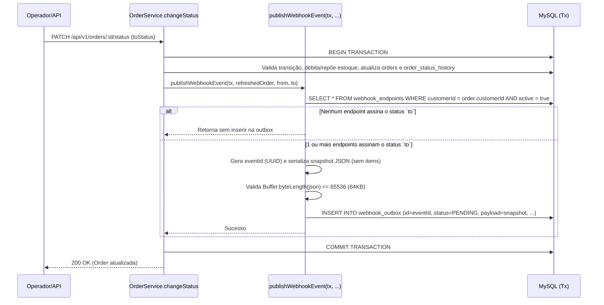

# FDD — Feature Design Document: Sistema de Webhooks de Notificação de Pedidos

- **ID do Documento**: `FDD-001`
- **Data**: 2026-10-21
- **Autor**: Larissa (Tech Lead), Bruno (Engenheiro Pleno — Pedidos), Diego (Engenheiro Sênior — Plataforma), Sofia (Engenheira de Segurança)
- **Documentos Relacionados**: [PRD (`docs/PRD.md`)](./PRD.md) | [RFC (`docs/RFC.md`)](./RFC.md) | [ADRs (`docs/adrs/`)](./adrs/)

---

## 1. Contexto e Motivação Técnica

O Order Management System (OMS) é uma API REST construída em Node.js $\ge 20$, TypeScript `5.6.3` e Express `4.21.1`, utilizando MySQL gerenciado via Prisma `5.22.0` (`prisma/schema.prisma`). O domínio central de pedidos (`src/modules/orders/`) implementa uma máquina de estados determinística (`PENDING` $\rightarrow$ `PAID` $\rightarrow$ `PROCESSING` $\rightarrow$ `SHIPPED` $\rightarrow$ `DELIVERED`, além de transições para `CANCELLED` em `src/modules/orders/order.status.ts`) e executa mudanças de status de forma transacional em `OrderService.changeStatus` (`src/modules/orders/order.service.ts`).

Atualmente, a aplicação não possui mecanismo de emissão de eventos ou notificações externas. Clientes B2B (Atlas Comercial, MaxDistribuição e Nova Cargo) realizam *polling* ativo sobre `GET /api/v1/orders` para identificar mudanças de status (`[09:00] Marcos`). Este FDD especifica em nível de implementação a construção do módulo de **Outbound Webhooks** (`src/modules/webhooks/`) e do **Worker de Entregas** (`src/worker.ts`), permitindo que qualquer desenvolvedor da equipe codifique a solução diretamente a partir deste documento.

---

## 2. Objetivos Técnicos

1. **Garantia Transacional na Geração de Eventos**: Registrar eventos de mudança de status na tabela `webhook_outbox` dentro da mesma transação `this.prisma.$transaction` de `OrderService.changeStatus` (`src/modules/orders/order.service.ts`), com snapshot JSON imutável e chave UUID (`[09:06] Diego`, `[09:40] Bruno`, `[09:51] Larissa`, `[09:52] Larissa`).
2. **Processamento Assíncrono com Baixa Latência**: Executar um processo worker independente (`src/worker.ts`) em loop de *polling* a cada 2 segundos para cumprir o SLA de notificação inferior a 10 segundos (`[09:02] Marcos`, `[09:09] Diego`, `[09:11] Diego`).
3. **Resiliência Determinística e Recuperação (DLQ)**: Aplicar timeout HTTP de 10 segundos por disparo (`[09:42] Diego`), realizar até 5 tentativas com *backoff* exponencial (`1m, 5m, 30m, 2h, 12h` — `[09:17] Diego`) e isolar falhas permanentes na tabela `webhook_dead_letter` com endpoint de replay manual restrito à role `ADMIN` (`[09:18] Diego`, `[09:36] Sofia`).
4. **Segurança Criptográfica e Validação Estrita**: Exigir URLs `https://` via Zod (`[09:23] Sofia`), impor limite de 64KB por payload (`[09:24] Diego`), assinar requisições com `HMAC-SHA256` por endpoint e suportar rotação de `secret` com *grace period* de 24 horas (`[09:20] Sofia`, `[09:21] Sofia`).
5. **Reuso Integral da Arquitetura do OMS**: Reutilizar `AppError` e `http-errors.ts` com códigos `WEBHOOK_*`, `errorMiddleware`, `authenticate` / `requireRole`, `validate` (Zod), `paginated` e `logger` (Pino) (`[09:27] Bruno` a `[09:30] Larissa`).

---

## 3. Escopo e Exclusões Técnicas

### Escopo Técnico Incluso
- Modelagem Prisma das tabelas `webhook_endpoints`, `webhook_outbox`, `webhook_deliveries` e `webhook_dead_letter` e enum `WebhookOutboxStatus`.
- Função pura transacional `publishWebhookEvent(tx, order, fromStatus, toStatus)` integrada ao método `OrderService.changeStatus` (`src/modules/orders/order.service.ts`).
- Endpoints REST para CRUD de endpoints de webhook, rotação de `secret`, listagem das últimas 100 entregas (`deliveries`) e replay administrativo da DLQ.
- Processo separado `src/worker.ts` (script `"worker"` no `package.json`) com loop de polling de 2s, disparo HTTP POST assinado via `HMAC-SHA256`, controle de tentativas/backoff e transição para DLQ.

### Exclusões Técnicas (Fora do Escopo desta Implementação)
- **Recebimento de Webhooks (*Inbound*)**: O sistema atua exclusivamente como emissor (*outbound*) (`[09:02] Marcos`, `[09:03] Sofia`).
- **Job de Arquivamento/Expurgo (>30 dias)**: A limpeza periódica de registros `DELIVERED` na `webhook_outbox` após 30 dias não será implementada nesta feature (`[09:08] Diego`).
- **Alertas por E-mail em Falhas Consecutivas**: Nenhum serviço de SMTP/e-mail será integrado nesta fase (`[09:37] Larissa`).
- **Rate Limiting de Saída e Escalonamento Multi-Worker**: O worker operará em instância única sem *throttling* por cliente na v1 (`[09:12] Diego`, `[09:39] Diego`).
- **Painel/Dashboard Visual (Frontend)**: A entrega restringe-se à API backend e ao worker (`[09:40] Larissa`).

---

## 4. Arquitetura de Dados e Fluxos Detalhados

### 4.1 Especificação do Modelo de Dados (`prisma/schema.prisma`)

Abaixo está a especificação das novas entidades a serem adicionadas ao schema Prisma do projeto (mantendo o padrão de chaves primárias `String @id @default(uuid()) @db.Char(36)` confirmado em `[09:51] Larissa`):

```prisma
enum WebhookOutboxStatus {
  PENDING
  PROCESSING
  DELIVERED
  FAILED
}

model WebhookEndpoint {
  id                      String    @id @default(uuid()) @db.Char(36)
  customerId              String    @db.Char(36)
  url                     String    @db.VarChar(500)
  secret                  String    @db.VarChar(128)
  previousSecret          String?   @db.VarChar(128)
  previousSecretExpiresAt DateTime?
  events                  Json      // Array de OrderStatus: ex. ["SHIPPED", "DELIVERED"]
  active                  Boolean   @default(true)
  createdAt               DateTime  @default(now())
  updatedAt               DateTime  @updatedAt

  customer    Customer            @relation(fields: [customerId], references: [id])
  outboxItems WebhookOutbox[]
  deliveries  WebhookDelivery[]
  deadLetters WebhookDeadLetter[]

  @@index([customerId, active])
  @@map("webhook_endpoints")
}

model WebhookOutbox {
  id            String              @id @default(uuid()) @db.Char(36)
  webhookId     String              @db.Char(36)
  orderId       String              @db.Char(36)
  eventType     String              @default("order.status_changed") @db.VarChar(64)
  payload       Json                // Snapshot JSON pré-renderizado (máx 64KB)
  status        WebhookOutboxStatus @default(PENDING)
  attempts      Int                 @default(0)
  nextAttemptAt DateTime            @default(now())
  lastError     String?             @db.VarChar(500)
  deliveredAt   DateTime?
  createdAt     DateTime            @default(now())
  updatedAt     DateTime            @updatedAt

  webhook    WebhookEndpoint    @relation(fields: [webhookId], references: [id], onDelete: Cascade)
  order      Order              @relation(fields: [orderId], references: [id], onDelete: Cascade)
  deliveries WebhookDelivery[]
  deadLetter WebhookDeadLetter?

  @@index([status, nextAttemptAt, createdAt])
  @@index([orderId, createdAt])
  @@map("webhook_outbox")
}

model WebhookDelivery {
  id             String   @id @default(uuid()) @db.Char(36)
  webhookId      String   @db.Char(36)
  outboxId       String   @db.Char(36)
  eventId        String   @db.Char(36)
  attemptNumber  Int
  success        Boolean
  requestPayload Json
  responseStatus Int?
  responseBody   String?  @db.Text
  durationMs     Int
  errorMessage   String?  @db.VarChar(500)
  createdAt      DateTime @default(now())

  webhook WebhookEndpoint @relation(fields: [webhookId], references: [id], onDelete: Cascade)
  outbox  WebhookOutbox   @relation(fields: [outboxId], references: [id], onDelete: Cascade)

  @@index([webhookId, createdAt(sort: Desc)])
  @@map("webhook_deliveries")
}

model WebhookDeadLetter {
  id            String    @id @default(uuid()) @db.Char(36)
  outboxId      String    @unique @db.Char(36)
  webhookId     String    @db.Char(36)
  orderId       String    @db.Char(36)
  payload       Json
  failureReason String    @db.VarChar(500)
  attempts      Int
  failedAt      DateTime  @default(now())
  replayedAt    DateTime?
  replayedById  String?   @db.Char(36)

  outbox     WebhookOutbox   @relation(fields: [outboxId], references: [id], onDelete: Cascade)
  webhook    WebhookEndpoint @relation(fields: [webhookId], references: [id], onDelete: Cascade)
  replayedBy User?           @relation("DeadLetterReplayedBy", fields: [replayedById], references: [id])

  @@index([webhookId, failedAt(sort: Desc)])
  @@map("webhook_dead_letter")
}
```

---

### 4.2 Fluxo 1 — Criação Atômica do Evento na Outbox (`FDD-FLOW-01`)

**Origem**: `[09:06] Diego`, `[09:33] Marcos`, `[09:34] Bruno`, `[09:40] Bruno`, `[09:41] Bruno`, `[09:43] Diego`, `[09:52] Larissa`.



**Regras de Execução**:
1. Dentro de `this.prisma.$transaction` em `OrderService.changeStatus` (`src/modules/orders/order.service.ts`), imediatamente após a criação do registro em `order_status_history` e leitura do `refreshed` order, chama-se `await publishWebhookEvent(tx, refreshed, from, to)`.
2. A função busca todos os `WebhookEndpoint` com `customerId = order.customerId` e `active = true` e filtra em memória aqueles cujo array `events` inclui `toStatus` (`[09:34] Bruno`).
3. Para cada endpoint elegível, gera-se um `eventId = randomUUID()` (`[09:25] Diego`, `[09:51] Larissa`) e monta-se o snapshot JSON (`[09:43] Diego`, `[09:52] Larissa`).
4. Verifica-se se o tamanho em bytes do JSON serializado é $\le 65.536\text{ bytes}$ (`64KB`). Caso exceda, lança-se `WebhookPayloadTooLargeError` (`WEBHOOK_PAYLOAD_TOO_LARGE`), abortando a transação com erro explícito (`[09:23] Sofia`, `[09:24] Diego`, `[09:24] Larissa`).
5. Insere-se o registro em `webhook_outbox` com `status = PENDING`, `attempts = 0` e `nextAttemptAt = new Date()`. Se o `INSERT` falhar, toda a transação de mudança de status sofre rollback (`[09:40] Bruno`).

---

### 4.3 Fluxo 2 — Processamento pelo Worker em Polling de 2 Segundos (`FDD-FLOW-02`)

**Origem**: `[09:08] Diego`, `[09:09] Diego`, `[09:11] Diego`, `[09:12] Diego`, `[09:20] Sofia`, `[09:42] Diego`, `[09:44] Diego`, `[09:44] Sofia`.

1. O processo independente `src/worker.ts` executa um loop assíncrono a cada `2000 ms` (2 segundos).
2. A cada ciclo, consulta um pequeno lote (ex.: `take: 20`) na tabela `webhook_outbox` onde `status = 'PENDING'` e `nextAttemptAt <= NOW()`, ordenado por `createdAt ASC` (garantindo ordenação FIFO implícita por `order_id` enquanto operar em *single-worker* — `[09:12] Diego`).
3. Para cada item do lote:
   - Marca o registro na `webhook_outbox` como `status = 'PROCESSING'`.
   - Serializa o snapshot `payload` e calcula a assinatura `HMAC-SHA256` utilizando a `secret` atual do `WebhookEndpoint` (e, caso `previousSecret` exista e `previousSecretExpiresAt > NOW()`, calcula também a assinatura secundária do *grace period* de 24h — `[09:21] Sofia`).
   - Dispara `POST <webhook.url>` com `AbortSignal.timeout(10_000)` (timeout de 10 segundos — `[09:42] Diego`) e cabeçalhos `Content-Type: application/json`, `X-Event-Id`, `X-Webhook-Id`, `X-Timestamp` e `X-Signature`.
   - Mede `durationMs` e grava o resultado na tabela `webhook_deliveries` (`[09:34] Marcos`).
   - Se a resposta for HTTP `2xx` (`200`–`299`), atualiza `webhook_outbox` para `status = 'DELIVERED'` e preenche `deliveredAt = NOW()`.

---

### 4.4 Fluxo 3 — Política de Retry e Backoff Exponencial (`FDD-FLOW-03`)

**Origem**: `[09:15] Diego`, `[09:16] Diego`, `[09:17] Diego`, `[09:17] Larissa`, `[09:42] Diego`.

Quando o disparo HTTP falha (resposta HTTP $\ge 300$, erro de conexão DNS/TCP/TLS ou timeout $> 10\text{s}$):
1. Incrementa-se o contador `nextAttemptNumber = outbox.attempts + 1`.
2. Registra-se a falha em `webhook_deliveries` (`success = false`, `responseStatus`, `responseBody`, `errorMessage`, `durationMs`).
3. Se `nextAttemptNumber < 5` (ou seja, ainda restam retentativas dentro do teto de 5 tentativas):
   - Calcula-se `nextAttemptAt` aplicando a tabela de *backoff* acordada em `[09:17] Diego`:

| Tentativa que Falhou (`attempts`) | Intervalo de Espera (Backoff) | Tempo Acumulado Desde o Evento Inicial |
| :---: | :---: | :---: |
| 1ª tentativa | `+ 1 minuto` (`60s`) | `1m` |
| 2ª tentativa | `+ 5 minutos` (`300s`) | `6m` |
| 3ª tentativa | `+ 30 minutos` (`1.800s`) | `36m` |
| 4ª tentativa | `+ 2 horas` (`7.200s`) | `2h 36m` |
| 5ª tentativa (última) | `+ 12 horas` (`43.200s`) | `14h 36m` (~15 horas) |

   - Atualiza-se o registro em `webhook_outbox` retornando `status = 'PENDING'`, `attempts = nextAttemptNumber`, `nextAttemptAt` calculado e `lastError`.

---

### 4.5 Fluxo 4 — Movimentação para Dead-Letter Queue (DLQ) e Replay Manual (`FDD-FLOW-04`)

**Origem**: `[09:18] Diego`, `[09:35] Diego`, `[09:36] Sofia`, `[09:36] Larissa`.

1. **Entrada na DLQ**: Caso a **5ª tentativa** falhe, o worker executa uma transação Prisma que:
   - Atualiza `webhook_outbox` para `status = 'FAILED'`, `attempts = 5` e `lastError`;
   - Insere um registro em `webhook_dead_letter` com `outboxId`, `webhookId`, `orderId`, `payload`, `failureReason`, `attempts = 5` e `failedAt = NOW()`.
2. **Replay Manual por `ADMIN`**: Quando um usuário com role `ADMIN` invoca `POST /api/v1/admin/webhooks/dead-letter/:id/replay`:
   - O serviço valida a existência do registro na `webhook_dead_letter` (`WEBHOOK_DEAD_LETTER_NOT_FOUND` se ausente) e verifica se já não foi reprocessado (`WEBHOOK_DEAD_LETTER_ALREADY_REPLAYED` se `replayedAt !== null`).
   - Em transação, atualiza `webhook_dead_letter` (`replayedAt = NOW()`, `replayedById = req.user.id`) e recoloca o registro correspondente em `webhook_outbox` com `status = 'PENDING'`, `attempts = 0` e `nextAttemptAt = NOW()` (`[09:18] Diego`).
   - Registra obrigatoriamente um log estruturado de auditoria via Pino informando `adminUserId`, `adminEmail`, `deadLetterId` e `outboxId` (`[09:36] Sofia`).

---

## 5. Contratos Públicos

Todas as rotas administrativas e de configuração são montadas sob o prefixo `/api/v1` (`src/app.ts`) e exigem cabeçalho `Authorization: Bearer <jwt>` validado pelo middleware `authenticate` (`src/middlewares/auth.middleware.ts`). Como o token JWT representa o usuário operador/administrador do OMS e não um cliente específico, o `customerId` é informado explicitamente no payload ou query string (`[09:32] Bruno`, `[09:32] Marcos`, `[09:32] Larissa`).

---

### 5.1 `POST /api/v1/webhooks` — Cadastrar Endpoint de Webhook (`FDD-EP-01`)

- **Autenticação / Autorização**: `authenticate` (qualquer role autenticada: `OPERATOR` ou `ADMIN` — `[09:36] Marcos`, `[09:37] Sofia`).
- **Semântica**: Cadastra um novo endpoint para um `Customer`, valida que a `url` utiliza `https://` (`[09:23] Sofia`) e que `events` contém valores válidos de `OrderStatus`, gera internamente uma `secret` criptográfica exclusiva (ex.: 32 bytes aleatórios em hex prefixados com `whsec_`) e retorna a `secret` na resposta de criação (`[09:21] Sofia`, `[09:31] Marcos`).
- **Headers de Request**:
  - `Authorization: Bearer <token>`
  - `Content-Type: application/json`
- **Request Body (Exemplo)**:
  ```json
  {
    "customerId": "550e8400-e29b-41d4-a716-446655440000",
    "url": "https://api.atlascomercial.com.br/webhooks/oms",
    "events": ["PAID", "PROCESSING", "SHIPPED", "DELIVERED", "CANCELLED"],
    "active": true
  }
  ```
- **Response `201 Created` (Exemplo)**:
  ```json
  {
    "id": "7c9e6679-7425-40de-944b-e07fc1f90ae7",
    "customerId": "550e8400-e29b-41d4-a716-446655440000",
    "url": "https://api.atlascomercial.com.br/webhooks/oms",
    "secret": "whsec_9f86d081884c7d659a2feaa0c55ad015a3bf4f1b2b0b822cd15d6c15b0f00a08",
    "events": ["PAID", "PROCESSING", "SHIPPED", "DELIVERED", "CANCELLED"],
    "active": true,
    "createdAt": "2026-10-21T12:00:00.000Z",
    "updatedAt": "2026-10-21T12:00:00.000Z"
  }
  ```
- **Status Codes**:
  - `201 Created`: Webhook cadastrado com sucesso.
  - `400 Bad Request`: URL não inicia com `https://` (`WEBHOOK_INVALID_URL`) ou lista `events` inválida (`WEBHOOK_INVALID_EVENTS` / `VALIDATION_ERROR`).
  - `401 Unauthorized`: Token JWT ausente ou inválido (`UNAUTHORIZED`).
  - `404 Not Found`: Cliente informado em `customerId` não existe (`WEBHOOK_CUSTOMER_NOT_FOUND`).

---

### 5.2 `GET /api/v1/webhooks` — Listar Webhooks de um Cliente (`FDD-EP-02`)

- **Autenticação / Autorização**: `authenticate` (`OPERATOR` ou `ADMIN` — `[09:33] Bruno`).
- **Query Params**: `customerId` (UUID, obrigatório), `page` (default `1`), `pageSize` (default `20`, máx `100`).
- **Semântica**: Lista os endpoints cadastrados para o `customerId` utilizando o envelope `paginated()` de `src/shared/http/response.ts` (omitindo a `secret` em texto plano após a criação).
- **Request (Exemplo)**:
  `GET /api/v1/webhooks?customerId=550e8400-e29b-41d4-a716-446655440000&page=1&pageSize=20`
- **Response `200 OK` (Exemplo)**:
  ```json
  {
    "data": [
      {
        "id": "7c9e6679-7425-40de-944b-e07fc1f90ae7",
        "customerId": "550e8400-e29b-41d4-a716-446655440000",
        "url": "https://api.atlascomercial.com.br/webhooks/oms",
        "events": ["PAID", "PROCESSING", "SHIPPED", "DELIVERED", "CANCELLED"],
        "active": true,
        "createdAt": "2026-10-21T12:00:00.000Z",
        "updatedAt": "2026-10-21T12:00:00.000Z"
      }
    ],
    "pagination": {
      "page": 1,
      "pageSize": 20,
      "total": 1,
      "totalPages": 1
    }
  }
  ```
- **Status Codes**: `200 OK`, `400 Bad Request` (`VALIDATION_ERROR`), `401 Unauthorized` (`UNAUTHORIZED`).

---

### 5.3 `PATCH /api/v1/webhooks/:id` — Atualizar Configuração de Webhook (`FDD-EP-03`)

- **Autenticação / Autorização**: `authenticate` (`OPERATOR` ou `ADMIN` — `[09:33] Bruno`, `[09:33] Marcos`).
- **Semântica**: Permite atualizar `url` (validando `https://`), a lista de `events` assinados e/ou a flag `active` de um endpoint existente.
- **Request Body (Exemplo)**:
  ```json
  {
    "url": "https://hooks.atlascomercial.com.br/v2/orders",
    "events": ["SHIPPED", "DELIVERED"],
    "active": true
  }
  ```
- **Response `200 OK` (Exemplo)**:
  ```json
  {
    "id": "7c9e6679-7425-40de-944b-e07fc1f90ae7",
    "customerId": "550e8400-e29b-41d4-a716-446655440000",
    "url": "https://hooks.atlascomercial.com.br/v2/orders",
    "events": ["SHIPPED", "DELIVERED"],
    "active": true,
    "createdAt": "2026-10-21T12:00:00.000Z",
    "updatedAt": "2026-10-21T12:15:00.000Z"
  }
  ```
- **Status Codes**: `200 OK`, `400 Bad Request` (`WEBHOOK_INVALID_URL` / `WEBHOOK_INVALID_EVENTS`), `401 Unauthorized`, `404 Not Found` (`WEBHOOK_NOT_FOUND`).

---

### 5.4 `DELETE /api/v1/webhooks/:id` — Remover Endpoint de Webhook (`FDD-EP-04`)

- **Autenticação / Autorização**: `authenticate` (`OPERATOR` ou `ADMIN` — `[09:33] Bruno`).
- **Semântica**: Remove o endpoint de webhook identificado por `:id`.
- **Request (Exemplo)**: `DELETE /api/v1/webhooks/7c9e6679-7425-40de-944b-e07fc1f90ae7`
- **Response**: `204 No Content` (corpo vazio).
- **Status Codes**: `204 No Content`, `401 Unauthorized`, `404 Not Found` (`WEBHOOK_NOT_FOUND`).

---

### 5.5 `POST /api/v1/webhooks/:id/rotate-secret` — Rotacionar Secret com Grace Period de 24h (`FDD-EP-05`)

- **Autenticação / Autorização**: `authenticate` (`OPERATOR` ou `ADMIN` — `[09:21] Sofia`, `[09:22] Sofia`).
- **Semântica**: Gera uma nova `secret` criptográfica para o endpoint, copia a `secret` anterior para `previousSecret` e define `previousSecretExpiresAt = NOW() + 24 horas`, permitindo que o cliente migre sua chave sem downtime (`[09:21] Sofia`).
- **Request Body**: `{}` (vazio).
- **Response `200 OK` (Exemplo)**:
  ```json
  {
    "id": "7c9e6679-7425-40de-944b-e07fc1f90ae7",
    "secret": "whsec_4b227777d4dd1fc61c6f884f48641d02b4d121d3fd328cb08b5531fcacdabf8a",
    "previousSecretValidUntil": "2026-10-22T12:30:00.000Z",
    "rotatedAt": "2026-10-21T12:30:00.000Z"
  }
  ```
- **Status Codes**: `200 OK`, `401 Unauthorized`, `404 Not Found` (`WEBHOOK_NOT_FOUND`).

---

### 5.6 `GET /api/v1/webhooks/:id/deliveries` — Consultar Histórico de Entregas (`FDD-EP-06`)

- **Autenticação / Autorização**: `authenticate` (`OPERATOR` ou `ADMIN` — `[09:34] Marcos`).
- **Semântica**: Retorna os últimos 100 disparos realizados para o endpoint `:id` (ordenados por `createdAt DESC`), incluindo indicador de sucesso/falha, payload enviado, status HTTP e corpo de resposta do cliente e tempo de resposta em milissegundos (`[09:34] Marcos`).
- **Request (Exemplo)**: `GET /api/v1/webhooks/7c9e6679-7425-40de-944b-e07fc1f90ae7/deliveries?limit=100`
- **Response `200 OK` (Exemplo)**:
  ```json
  {
    "data": [
      {
        "id": "c4b02f10-8119-4a1c-9a0b-1029384756ab",
        "webhookId": "7c9e6679-7425-40de-944b-e07fc1f90ae7",
        "eventId": "f47ac10b-58cc-4372-a567-0e02b2c3d479",
        "attemptNumber": 1,
        "success": true,
        "requestPayload": {
          "event_id": "f47ac10b-58cc-4372-a567-0e02b2c3d479",
          "event_type": "order.status_changed",
          "timestamp": "2026-10-21T12:10:00.000Z",
          "order_id": "9b1deb4d-3b7d-4bad-9bdd-2b0d7b3dcb6d",
          "order_number": "ORD-000042",
          "customer_id": "550e8400-e29b-41d4-a716-446655440000",
          "from_status": "PROCESSING",
          "to_status": "SHIPPED",
          "subtotal_cents": 150000,
          "discount_cents": 5000,
          "total_cents": 145000
        },
        "responseStatus": 200,
        "responseBody": "{\"received\":true}",
        "durationMs": 184,
        "errorMessage": null,
        "createdAt": "2026-10-21T12:10:01.200Z"
      }
    ]
  }
  ```
- **Status Codes**: `200 OK`, `401 Unauthorized`, `404 Not Found` (`WEBHOOK_NOT_FOUND`).

---

### 5.7 `POST /api/v1/admin/webhooks/dead-letter/:id/replay` — Reprocessar Evento da DLQ (`FDD-EP-07`)

- **Autenticação / Autorização**: `authenticate` + `requireRole('ADMIN')` (`src/middlewares/auth.middleware.ts` — `[09:18] Diego`, `[09:35] Diego`, `[09:36] Sofia`, `[09:36] Larissa`).
- **Semântica**: Recoloca um evento da tabela `webhook_dead_letter` de volta na `webhook_outbox` como `PENDING` (`attempts = 0`, `nextAttemptAt = NOW()`) e grava log de auditoria identificando o administrador que executou a ação (`[09:18] Diego`, `[09:36] Sofia`).
- **Request Body**: `{}` (vazio).
- **Response `200 OK` (Exemplo)**:
  ```json
  {
    "deadLetterId": "a1b2c3d4-e5f6-7890-abcd-ef1234567890",
    "outboxId": "f47ac10b-58cc-4372-a567-0e02b2c3d479",
    "status": "PENDING",
    "replayedBy": "11111111-2222-3333-4444-555555555555",
    "replayedAt": "2026-10-21T14:00:00.000Z"
  }
  ```
- **Status Codes**:
  - `200 OK`: Evento reenfileirado com sucesso na `webhook_outbox`.
  - `401 Unauthorized`: Token ausente ou inválido (`UNAUTHORIZED`).
  - `403 Forbidden`: Usuário autenticado possui role `OPERATOR` em vez de `ADMIN` (`FORBIDDEN`).
  - `404 Not Found`: Registro não encontrado na DLQ (`WEBHOOK_DEAD_LETTER_NOT_FOUND`).
  - `409 Conflict`: Registro da DLQ já foi reprocessado anteriormente (`WEBHOOK_DEAD_LETTER_ALREADY_REPLAYED`).

---

### 5.8 Contrato de Saída (Outbound HTTP POST enviado pelo Worker ao Cliente) (`FDD-EP-08`)

- **Método e Destino**: `POST <webhookEndpoint.url>` (obrigatoriamente `https://` — `[09:23] Sofia`).
- **Timeout de Rede/Resposta**: `10.000 ms` (10 segundos — `[09:42] Diego`).
- **Tamanho Máximo do Corpo**: `64 KB` (`65.536 bytes` — `[09:24] Diego`, `[09:24] Larissa`).
- **Cabeçalhos HTTP Obrigatórios** (`[09:20] Sofia`, `[09:25] Diego`, `[09:44] Diego`, `[09:44] Sofia`):
  ```http
  POST /webhooks/oms HTTP/1.1
  Host: api.atlascomercial.com.br
  Content-Type: application/json
  X-Event-Id: f47ac10b-58cc-4372-a567-0e02b2c3d479
  X-Webhook-Id: 7c9e6679-7425-40de-944b-e07fc1f90ae7
  X-Timestamp: 2026-10-21T12:10:01.000Z
  X-Signature: sha256=8f4e2a1b9c3d7e6f5a0b1c2d3e4f5a6b7c8d9e0f1a2b3c4d5e6f7a8b9c0d1e2f
  ```
  *(Nota: Durante a janela de 24h após uma rotação de secret, se `previousSecretExpiresAt > NOW()`, o cabeçalho inclui o segundo digest separado por vírgula `sha256=<hmac_atual>,sha256_prev=<hmac_anterior>` ou header complementar `X-Signature-Previous` para permitir verificação com ambas as chaves em paralelo — `[09:21] Sofia`).*
- **Payload JSON Enviado (Snapshot enxuto, sem `items`)** (`[09:43] Diego`, `[09:52] Larissa`):
  ```json
  {
    "event_id": "f47ac10b-58cc-4372-a567-0e02b2c3d479",
    "event_type": "order.status_changed",
    "timestamp": "2026-10-21T12:10:00.000Z",
    "order_id": "9b1deb4d-3b7d-4bad-9bdd-2b0d7b3dcb6d",
    "order_number": "ORD-000042",
    "customer_id": "550e8400-e29b-41d4-a716-446655440000",
    "from_status": "PROCESSING",
    "to_status": "SHIPPED",
    "subtotal_cents": 150000,
    "discount_cents": 5000,
    "total_cents": 145000
  }
  ```
- **Semântica de Resposta Esperada do Cliente**:
  - Qualquer status HTTP `2xx` (`200 OK`, `201 Created`, `202 Accepted`, `204 No Content`) recebido em até 10 segundos encerra a entrega com sucesso (`DELIVERED`).
  - Qualquer status HTTP $\ge 300$, erro de transporte ou tempo $> 10\text{s}$ é tratado como falha e aciona a política de retry.

---

## 6. Matriz de Erros Previstos

Seguindo a convenção de `src/shared/errors/app-error.ts`, `src/shared/errors/http-errors.ts` e `src/middlewares/error.middleware.ts`, todos os erros do módulo utilizam o prefixo `WEBHOOK_` (`[09:28] Bruno`, `[09:29] Larissa`) e retornam o envelope JSON `{ "error": { "code": "WEBHOOK_*", "message": "...", "details": ... } }`:

| ID | Código de Erro (`errorCode`) | HTTP Status | Classe Base (`http-errors.ts`) | Condição de Disparo e Semântica | Origem |
| :--- | :--- | :---: | :--- | :--- | :--- |
| `FDD-ERR-01` | `WEBHOOK_NOT_FOUND` | `404` | `NotFoundError` / `AppError` | Endpoint de webhook com o `:id` informado não existe em `webhook_endpoints`. | `[09:28] Bruno` |
| `FDD-ERR-02` | `WEBHOOK_INVALID_URL` | `400` | `ValidationError` / `BadRequestError` | URL informada no cadastro ou edição não utiliza protocolo `https://` ou é sintaticamente inválida. | `[09:23] Sofia`, `[09:28] Bruno` |
| `FDD-ERR-03` | `WEBHOOK_SECRET_REQUIRED` | `422` | `UnprocessableEntityError` | Endpoint sem `secret` válida configurada no momento de assinatura ou rotação. | `[09:28] Bruno` |
| `FDD-ERR-04` | `WEBHOOK_INVALID_EVENTS` | `400` | `ValidationError` | Lista `events` vazia ou contendo status inexistente no enum `OrderStatus` (`src/modules/orders/order.status.ts`). | `[09:31] Marcos`, `[09:33] Marcos` |
| `FDD-ERR-05` | `WEBHOOK_CUSTOMER_NOT_FOUND` | `404` | `NotFoundError` / `AppError` | O `customerId` informado em `POST /api/v1/webhooks` não corresponde a nenhum registro em `customers`. | `[09:32] Larissa` |
| `FDD-ERR-06` | `WEBHOOK_PAYLOAD_TOO_LARGE` | `422` | `UnprocessableEntityError` | O snapshot JSON serializado para a `webhook_outbox` excede o teto de 64KB (`65.536 bytes`). | `[09:23] Sofia`, `[09:24] Diego`, `[09:24] Larissa` |
| `FDD-ERR-07` | `WEBHOOK_DEAD_LETTER_NOT_FOUND` | `404` | `NotFoundError` / `AppError` | Registro `:id` não encontrado na tabela `webhook_dead_letter` durante chamada de replay. | `[09:18] Diego`, `[09:35] Diego` |
| `FDD-ERR-08` | `WEBHOOK_DEAD_LETTER_ALREADY_REPLAYED` | `409` | `ConflictError` | Tentativa de reprocessar um item da DLQ que já possui `replayedAt` preenchido. | `[09:18] Diego`, `[09:35] Diego` |
| `FDD-ERR-09` | `WEBHOOK_DELIVERY_TIMEOUT` | N/A (Worker) | Código interno de falha em `webhook_deliveries` / `webhook_dead_letter` | Chamada HTTP POST para o endpoint do cliente excedeu o timeout de 10 segundos (`10000 ms`). | `[09:42] Sofia`, `[09:42] Diego` |
| `FDD-ERR-10` | `WEBHOOK_DELIVERY_FAILED` | N/A (Worker) | Código interno de falha em `webhook_deliveries` / `webhook_dead_letter` | Endpoint do cliente retornou status HTTP não-2xx ou erro de conexão TCP/TLS. | `[09:15] Diego`, `[09:18] Diego` |

---

## 7. Estratégias de Resiliência

1. **Timeout Estrito de 10 Segundos por Disparo (`FDD-RES-01`)**: Toda requisição de saída do worker utiliza `AbortSignal.timeout(10_000)` para impedir que servidores lentos de clientes prendam o loop de processamento (`[09:42] Sofia`, `[09:42] Diego`).
2. **Backoff Exponencial de 5 Tentativas em ~15 Horas (`FDD-RES-02`)**: A progressão `1m, 5m, 30m, 2h, 12h` absorve desde instabilidades momentâneas de rede até janelas de manutenção planejada de clientes (tipicamente 2 horas) sem descartar eventos prematuramente (`[09:15] Diego`, `[09:16] Diego`, `[09:17] Diego`).
3. **Isolamento em Dead-Letter Queue e Fallback de Replay (`FDD-RES-03`)**: Eventos que falham nas 5 tentativas saem do caminho crítico de leitura da `webhook_outbox` e são persistidos em `webhook_dead_letter`, permitindo inspeção e replay manual controlado via endpoint administrativo (`[09:18] Diego`, `[09:35] Diego`).
4. **Rotação de Credenciais com Grace Period de 24 Horas (`FDD-RES-04`)**: Durante 24 horas após `POST /api/v1/webhooks/:id/rotate-secret`, a secret antiga (`previousSecret`) permanece válida paralelamente à nova `secret`, garantindo zero perda de entregas durante a atualização de credenciais no cliente (`[09:21] Sofia`, `[09:22] Sofia`).
5. **Proteção de Memória e Rede com Teto de 64KB e Payload Enxuto (`FDD-RES-05`)**: O snapshot do evento omite os itens do pedido (`items`) (`[09:43] Diego`) e bloqueia qualquer payload $> 64\text{KB}$ com erro explícito `WEBHOOK_PAYLOAD_TOO_LARGE` (`[09:23] Sofia`, `[09:24] Diego`).

---

## 8. Observabilidade

A estratégia de observabilidade apoia-se nos três pilares obrigatórios (métricas, logs e tracing), integrados ao logger estruturado Pino (`src/shared/logger/index.ts`):

1. **Métricas (`FDD-OBS-01`)**:
   - **Latência de Entrega (`durationMs`)**: Medida em milissegundos a cada tentativa e persistida na coluna `durationMs` de `webhook_deliveries` (`[09:34] Marcos`), permitindo acompanhar percentis ($p50, p95, p99$) e o cumprimento do SLA $< 10\text{s}$ (`[09:02] Marcos`).
   - **Taxa de Sucesso, Retries e Profundidade da Fila**: Contabilização de eventos por estado na `webhook_outbox` (`PENDING`, `PROCESSING`, `DELIVERED`, `FAILED`), contagem de tentativas (`attemptNumber` 1 a 5) e volume de entradas na `webhook_dead_letter` (`[09:08] Diego`, `[09:17] Diego`, `[09:18] Diego`).
2. **Logs Estruturados e Auditoria via Pino (`FDD-OBS-02`)**:
   - Reuso integral de `src/shared/logger/index.ts` tanto na API quanto no processo `src/worker.ts` (`[09:29] Bruno`).
   - **Auditoria Obrigatória de Replay Administrativo**: Toda execução de `POST /api/v1/admin/webhooks/dead-letter/:id/replay` emite um log estruturado `logger.info({ event: 'webhook_dlq_replayed', deadLetterId, outboxId, adminUserId: req.user.id, adminEmail: req.user.email })` conforme exigido por Segurança (`[09:36] Sofia`).
   - **Redaction de Secrets**: Extensão da lista `redactPaths` em `src/shared/logger/index.ts` para incluir `'*.secret'` e `'*.previousSecret'`, prevenindo vazamento de chaves HMAC em logs (`[09:21] Sofia`, `[09:22] Diego`).
3. **Tracing e Correlação Distribuída (`FDD-OBS-03`)**:
   - **Na API HTTP**: Correlação via `requestId` (`req.id`) gerado pelo middleware `src/middlewares/request-logger.middleware.ts` e propagado em `src/middlewares/error.middleware.ts`.
   - **Assíncrono (Outbox $\rightarrow$ Worker $\rightarrow$ Cliente)**: Propagação fim a fim do UUID do evento através do cabeçalho `X-Event-Id` (e campo `event_id` no JSON) e do identificador da assinatura em `X-Webhook-Id` (`[09:25] Diego`, `[09:44] Diego`, `[09:44] Sofia`), presentes também em todos os logs do worker e registros de `webhook_deliveries`.

---

## 9. Dependências e Compatibilidade

- **Runtime e Bibliotecas Nativas**: Node.js $\ge 20$ (`package.json`), utilizando os módulos nativos `node:crypto` (`createHmac('sha256', secret)`, `randomBytes`, `randomUUID`) para geração de secrets e assinatura HMAC, e `fetch` nativo do Node 20 com `AbortSignal.timeout(10_000)` para os disparos HTTP do worker — sem necessidade de adicionar novas dependências externas ao `package.json`.
- **Banco de Dados e ORM**: MySQL existente via `@prisma/client` (`^5.22.0`). A adição das 4 novas tabelas e relacionamentos reversos em `Customer`, `Order` e `User` é 100% retrocompatível e não altera nenhuma coluna existente.
- **Compatibilidade com Clientes**: Caso um cliente B2B não possua nenhum endpoint cadastrado em `webhook_endpoints`, `publishWebhookEvent` retorna imediatamente sem inserir registros na `webhook_outbox` (`[09:34] Bruno`), mantendo comportamento idêntico ao atual para todas as rotas existentes de `/api/v1/orders`.

---

## 10. Integração com o Sistema Existente

Esta seção mapeia explicitamente como o novo módulo `src/modules/webhooks/` e o processo `src/worker.ts` se integram aos arquivos reais do código base do OMS:

| ID | Caminho Real no Repositório | Componente Existente | Especificação Detalhada da Integração |
| :--- | :--- | :--- | :--- |
| `FDD-INT-01` | `prisma/schema.prisma` | Modelos `User`, `Customer`, `Order`, `OrderStatusHistory` e enum `OrderStatus` | Adição do enum `WebhookOutboxStatus` e dos modelos `WebhookEndpoint` (`webhook_endpoints`), `WebhookOutbox` (`webhook_outbox`), `WebhookDelivery` (`webhook_deliveries`) e `WebhookDeadLetter` (`webhook_dead_letter`) usando chaves `String @id @default(uuid()) @db.Char(36)` (`[09:51] Larissa`), além das relações em `Customer`, `Order` e `User`. |
| `FDD-INT-02` | `src/modules/orders/order.service.ts` | Método `OrderService.changeStatus` (linhas 126–179) que executa `this.prisma.$transaction` | Dentro do bloco `this.prisma.$transaction(async (tx) => { ... })`, logo após `tx.orderStatusHistory.create` e a leitura de `refreshed`, invoca-se `await publishWebhookEvent(tx, refreshed!, from, to)` (`[09:40] Bruno`, `[09:41] Bruno`, `[09:41] Diego`). Se a gravação na `webhook_outbox` falhar, toda a transação sofre rollback. |
| `FDD-INT-03` | `src/modules/orders/order.status.ts` | Máquina de estados e enum `OrderStatus` (`PENDING`, `PAID`, `PROCESSING`, `SHIPPED`, `DELIVERED`, `CANCELLED`) | O enum `OrderStatus` é importado em `src/modules/webhooks/webhook.schemas.ts` para validar o array `events` no cadastro/edição de webhooks (`z.array(z.nativeEnum(OrderStatus)).min(1)`) e filtrar assinaturas na inserção da outbox (`[09:33] Marcos`, `[09:34] Bruno`). |
| `FDD-INT-04` | `src/shared/errors/app-error.ts` | Classe base `AppError(message, statusCode, errorCode, details)` | Base direta para todos os erros de domínio do módulo de webhooks, preservando os campos `statusCode`, `errorCode` (`WEBHOOK_*`) e `details` (`[09:28] Bruno`, `[09:29] Larissa`). |
| `FDD-INT-05` | `src/shared/errors/http-errors.ts` | Subclasses `BadRequestError`, `ValidationError`, `NotFoundError`, `ConflictError`, `UnprocessableEntityError` | Extensão/instanciação para criar os erros específicos `WEBHOOK_NOT_FOUND`, `WEBHOOK_INVALID_URL`, `WEBHOOK_SECRET_REQUIRED`, `WEBHOOK_INVALID_EVENTS`, `WEBHOOK_CUSTOMER_NOT_FOUND`, `WEBHOOK_PAYLOAD_TOO_LARGE`, `WEBHOOK_DEAD_LETTER_NOT_FOUND` e `WEBHOOK_DEAD_LETTER_ALREADY_REPLAYED`, seguindo exatamente o molde de `InvalidStatusTransitionError` e `InsufficientStockError` (`[09:28] Bruno`). |
| `FDD-INT-06` | `src/middlewares/error.middleware.ts` | Middleware global `errorMiddleware` | Nenhuma modificação necessária no código do middleware: por verificar `if (err instanceof AppError)`, todas as exceções `WEBHOOK_*` lançadas pelos novos controllers/services são automaticamente serializadas com status HTTP e código corretos (`[09:29] Bruno`). |
| `FDD-INT-07` | `src/middlewares/auth.middleware.ts` | Middlewares `authenticate` e `requireRole(...roles)` | `authenticate` protege todas as rotas de `/api/v1/webhooks`; `requireRole('ADMIN')` protege exclusivamente a rota `POST /api/v1/admin/webhooks/dead-letter/:id/replay`, barrando usuários `OPERATOR` com `403 FORBIDDEN` e fornecendo `req.user` para o log de auditoria (`[09:32] Larissa`, `[09:36] Sofia`, `[09:36] Larissa`). |
| `FDD-INT-08` | `src/middlewares/validate.middleware.ts` | Middleware `validate({ body, query, params })` | Aplicado nas rotas de `src/modules/webhooks/webhook.routes.ts` para validar schemas Zod de criação (`url` iniciando com `https://`), atualização, parâmetros `:id` UUID e query de paginação (`[09:23] Sofia`, `[09:30] Larissa`). |
| `FDD-INT-09` | `src/shared/logger/index.ts` | Factory `createLogger()` e instância `logger` (Pino) | Reutilizado em `src/modules/webhooks/` para log de auditoria de replay da DLQ (`[09:36] Sofia`) e em `src/worker.ts` para telemetria dos ciclos de polling, retries e falhas (`[09:29] Bruno`), adicionando `'*.secret'` e `'*.previousSecret'` em `redactPaths`. |
| `FDD-INT-10` | `src/shared/http/response.ts` | Função utilitária `paginated(data, page, pageSize, total)` | Reutilizada no `WebhookService.list` (`GET /api/v1/webhooks`) para devolver a lista paginada no mesmo formato de `OrderService.list`. |
| `FDD-INT-11` | `src/routes/index.ts` & `src/app.ts` | `buildControllers(prisma)` em `src/app.ts` e `buildApiRouter(controllers)` em `src/routes/index.ts` | Instanciação de `WebhookRepository`, `WebhookService` e `WebhookController` em `buildControllers` (`src/app.ts`) e montagem de `router.use('/webhooks', buildWebhookRouter(controllers.webhooks))` e `router.use('/admin/webhooks', buildAdminWebhookRouter(controllers.webhooks))` em `buildApiRouter` (`src/routes/index.ts`). |
| `FDD-INT-12` | `src/server.ts` & `src/config/database.ts` | Bootstrap HTTP (`src/server.ts`) e `createPrismaClient()` (`src/config/database.ts`) | O novo entrypoint `src/worker.ts` segue exatamente a estrutura de inicialização e captura de sinais `SIGINT`/`SIGTERM` de `src/server.ts` (`[09:11] Larissa`), instanciando uma conexão dedicada ao banco via `createPrismaClient()` de `src/config/database.ts` (`[09:30] Bruno`). |

### Exemplo de Integração em `src/modules/orders/order.service.ts`

```typescript
// Dentro de OrderService.changeStatus (src/modules/orders/order.service.ts, após linha 168):
const refreshed = await tx.order.findUnique({
  where: { id },
  include: {
    items: { include: { product: { select: { id: true, sku: true, name: true } } } },
    history: { orderBy: { changedAt: 'asc' } },
    customer: { select: { id: true, name: true, email: true } },
  },
});

// Gancho atômico na mesma transação Prisma ([09:40] Bruno, [09:41] Bruno, [09:41] Diego):
await publishWebhookEvent(tx, refreshed!, from, to);

return refreshed!;
```

---

## 11. Critérios de Aceite Técnicos

1. **Atomicidade da Outbox**: Quando `PATCH /api/v1/orders/:id/status` transita um pedido cujo cliente possui webhook ativo para o status de destino, um registro `PENDING` com snapshot JSON ($\le 64\text{KB}$, sem `items`) é gravado em `webhook_outbox` na mesma transação; se o cliente não assinar aquele status, nenhuma linha é criada em `webhook_outbox`.
2. **Validação de Cadastro e Segurança**: `POST /api/v1/webhooks` e `PATCH /api/v1/webhooks/:id` rejeitam URLs `http://` com `400 Bad Request` (`WEBHOOK_INVALID_URL`) e geram `secret` exclusiva na criação.
3. **Rotação de Secret**: `POST /api/v1/webhooks/:id/rotate-secret` gera nova `secret` e preserva `previousSecret` válida por 24 horas.
4. **Disparo pelo Worker e Headers**: O processo `src/worker.ts` realiza polling a cada 2 segundos e envia `POST` para o endpoint do cliente com timeout de 10s e cabeçalhos `X-Event-Id`, `X-Webhook-Id`, `X-Timestamp`, `X-Signature` (`HMAC-SHA256`) e `Content-Type: application/json`.
5. **Curva de Retry e DLQ**: Falhas consecutivas agendam `nextAttemptAt` em `+1m`, `+5m`, `+30m`, `+2h` e `+12h`; na 5ª falha, o evento recebe `status = FAILED` na outbox e é copiado para `webhook_dead_letter`.
6. **Histórico e Replay Admin**: `GET /api/v1/webhooks/:id/deliveries` retorna os últimos 100 disparos com status, payload, response e `durationMs`; `POST /api/v1/admin/webhooks/dead-letter/:id/replay` exige `requireRole('ADMIN')`, reenfileira o evento como `PENDING` e emite log de auditoria no Pino.

---

## 12. Riscos Técnicos e Mitigação

| Risco Técnico | Impacto Técnico | Mitigação no Desenho |
| :--- | :--- | :--- |
| **Lentidão na transação de `OrderService.changeStatus` durante inserção na outbox** | Aumento de latência no endpoint `PATCH /api/v1/orders/:id/status`. | Índice composto `@@index([customerId, active])` em `webhook_endpoints`, filtragem na inserção (`[09:34] Bruno`) e zero I/O de rede dentro da transação (`[09:04] Bruno`, `[09:06] Diego`). |
| **Degradação do polling em `webhook_outbox` com acúmulo de registros** | Queries de polling a cada 2s ficarem lentas ao varrer linhas antigas. | Índice composto `@@index([status, nextAttemptAt, createdAt])` garantindo leitura restrita a `status = 'PENDING'` em batches pequenos (`[09:08] Diego`) e isolamento de falhas definitivas na tabela `webhook_dead_letter` (`[09:18] Diego`). |
| **Exposição acidental de `secret` em logs ou erro na validação HMAC** | Comprometimento da autenticidade dos webhooks ou rejeição de payloads legítimos no cliente. | Inclusão de `*.secret` e `*.previousSecret` no `redactPaths` de `src/shared/logger/index.ts`, testes automatizados de assinatura e revisão de segurança dedicada de 2 dias úteis pela Sofia antes do deploy (`[09:46] Sofia`). |
| **Concorrência indevida caso mais de um processo `worker` seja iniciado** | Eventos do mesmo pedido entregues fora de ordem ou em duplicidade. | Execução estritamente em *single-worker* na v1 (`[09:12] Diego`, `[09:13] Larissa`) e transição atômica de status `PENDING` $\rightarrow$ `PROCESSING` antes do disparo HTTP. |
