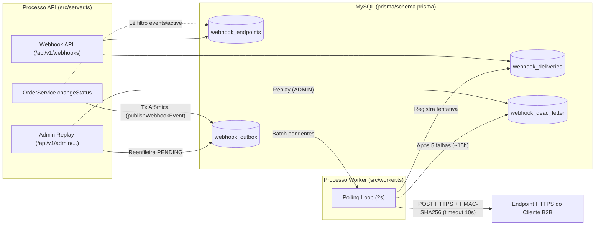

# RFC — Arquitetura do Sistema de Webhooks de Notificação de Pedidos (Outbound)

## Metadados

| Campo | Valor |
| :--- | :--- |
| **ID do Documento** | `RFC-001` |
| **Título** | Arquitetura Assíncrona de Outbound Webhooks via Transactional Outbox |
| **Autor** | Larissa (Tech Lead) & Time de Engenharia OMS |
| **Status** | Em Revisão / Aprovado em Reunião Técnica (`[09:48] Larissa`, `[09:49] Diego`) |
| **Data** | 2026-10-21 |
| **Revisores** | **Larissa** (Tech Lead), **Marcos** (Product Manager), **Bruno** (Engenheiro Pleno — Pedidos), **Diego** (Engenheiro Sênior — Plataforma), **Sofia** (Engenheira de Segurança) |
| **Estimativa de Entrega** | 3 Sprints (incluindo janela de 2 dias úteis de revisão de segurança — `[09:46] Larissa`, `[09:46] Sofia`) |

---

## Resumo Executivo (TL;DR)

Este RFC propõe a arquitetura de um sistema de **outbound webhooks** para notificar clientes B2B do Order Management System (OMS) sempre que o status de seus pedidos sofrer alteração, atendendo ao SLA de negócio de entrega em menos de 10 segundos (`[09:00] Marcos`, `[09:02] Marcos`).

A solução adota o padrão **Transactional Outbox no MySQL existente** acoplado atomicamente à transação de mudança de status (`OrderService.changeStatus` em `src/modules/orders/order.service.ts`), consumido por um **worker Node.js em processo separado** via *polling* a cada 2 segundos (`[09:06] Diego`, `[09:09] Diego`, `[09:11] Diego`). O desenho inclui política de resiliência de **5 retentativas com backoff exponencial** (`1m, 5m, 30m, 2h, 12h`) e **Dead-Letter Queue (DLQ)** em tabela dedicada com replay manual restrito a `ADMIN` (`[09:17] Diego`, `[09:18] Diego`, `[09:36] Sofia`), autenticação criptográfica **HMAC-SHA256 com secret única por endpoint e rotação com grace period de 24h** (`[09:21] Sofia`), e semântica de entrega **at-least-once com idempotência via `X-Event-Id`** (`[09:24] Diego`, `[09:25] Diego`).

> **Nota de Escopo Documental**: Este RFC foca nas decisões arquiteturais, trade-offs e questões em aberto. O detalhamento de implementação (schemas de tabelas, payloads JSON de request/response, matriz de erros `WEBHOOK_*` e ganchos linha a linha no código) encontra-se especificado no [FDD (`docs/FDD.md`)](./FDD.md).

---

## Contexto e Problema

Atualmente, o OMS processa pedidos através de uma máquina de estados estrita (`PENDING`, `PAID`, `PROCESSING`, `SHIPPED`, `DELIVERED`, `CANCELLED` em `src/modules/orders/order.status.ts`), mas não possui qualquer mecanismo ativo de notificação externa. Três clientes B2B estratégicos — **Atlas Comercial**, **MaxDistribuição** e **Nova Cargo** — dependem de atualizações de status e hoje executam *polling* repetitivo no endpoint `GET /api/v1/orders`, tornando a integração lenta e custosa (`[09:00] Marcos`). A Atlas Comercial sinalizou risco de migração para a concorrência (*churn*) caso a capacidade de notificação ativa não seja entregue até o fim do trimestre (`[09:00] Marcos`, `[09:45] Marcos`).

Do ponto de vista arquitetural, o problema exige resolver quatro tensões simultâneas:
1. **Isolamento Transacional**: A mudança de status em `src/modules/orders/order.service.ts` já executa operações críticas dentro de `this.prisma.$transaction` (atualização de `orders`, inserção em `order_status_history` e débito/reposição de estoque em `products`). Chamadas de rede externas não podem bloquear essa transação nem causar rollback da mudança de status se o servidor do cliente estiver indisponível (`[09:04] Bruno`).
2. **Garantia contra Perda de Eventos**: Não pode ocorrer mudança de status commitada no banco sem o respectivo registro do evento de notificação (`[09:06] Diego`, `[09:40] Bruno`).
3. **Resiliência a Indisponibilidades Externas**: Servidores de clientes sofrem oscilações e manutenções planejadas (historicamente de até 2 horas — `[09:16] Diego`), exigindo retentativas espaçadas e trilha de recuperação para falhas permanentes.
4. **Segurança na Fronteira Externa**: Como o tráfego sai da infraestrutura do OMS para endpoints públicos dos clientes, é indispensável garantir autenticidade, integridade em trânsito e isolamento de credenciais por endpoint (`[09:19] Sofia`, `[09:21] Sofia`).

---

## Proposta Técnica

A arquitetura proposta estrutura-se em seis pilares complementares, desenhados para operar sobre a stack existente do OMS (Node.js, TypeScript, Express, MySQL via Prisma, Zod e Pino):

1. **Padrão Transactional Outbox no MySQL (`RFC-PROP-01`)**:
   - Dentro da mesma transação SQL de `OrderService.changeStatus` (`src/modules/orders/order.service.ts`), uma função pura `publishWebhookEvent(tx, order, fromStatus, toStatus)` consulta os endpoints ativos do cliente que assinam o novo status (`[09:34] Bruno`, `[09:41] Bruno`).
   - Havendo interesse, grava o evento na tabela `webhook_outbox` com chave UUID (`[09:51] Larissa`) e **snapshot JSON já renderizado** no momento da inserção (`[09:52] Larissa`, `[09:52] Diego`), contendo os dados essenciais do pedido sem a lista de itens (`[09:43] Diego`).
2. **Worker Independente em Polling de 2 Segundos (`RFC-PROP-02`)**:
   - Um processo Node.js separado (`src/worker.ts`, seguindo o padrão de ciclo de vida de `src/server.ts`) instancia seu próprio `PrismaClient` (`src/config/database.ts`) e consulta a `webhook_outbox` a cada **2 segundos** em pequenos lotes ordenados por `created_at` (`[09:08] Diego`, `[09:09] Diego`, `[09:11] Larissa`, `[09:30] Bruno`).
   - Na v1, opera em instância única (*single-worker*), garantindo ordenação implícita por `order_id` e atendendo com folga a meta de latência $< 10\text{s}$ (`[09:10] Larissa`, `[09:12] Diego`).
3. **Política de Retry Exponencial e Dead-Letter Queue (`RFC-PROP-03`)**:
   - Cada disparo HTTP aplica timeout de **10 segundos** (`[09:42] Diego`). Em caso de falha, o evento sofre até **5 retentativas** com progressão de backoff de `1m → 5m → 30m → 2h → 12h` (~15 horas de janela total — `[09:17] Diego`).
   - Após a 5ª falha, o evento é movido para uma tabela dedicada `webhook_dead_letter`, podendo ser reenfileirado manualmente via endpoint administrativo protegido por `requireRole('ADMIN')` (`src/middlewares/auth.middleware.ts`) com log de auditoria obrigatório (`[09:18] Diego`, `[09:36] Sofia`).
4. **Segurança Criptográfica e Transporte (`RFC-PROP-04`)**:
   - Cadastro restrito a URLs `https://` validadas via Zod (`[09:23] Sofia`) e limite estrito de **64KB** por payload (`[09:24] Diego`).
   - Assinatura `HMAC-SHA256` sobre o corpo da requisição enviada em `X-Signature` (junto aos cabeçalhos `X-Timestamp` e `X-Webhook-Id`), utilizando uma `secret` exclusiva por endpoint com suporte a rotação sem downtime via **grace period de 24 horas** (`[09:20] Sofia`, `[09:21] Sofia`, `[09:44] Diego`, `[09:44] Sofia`).
5. **Entrega *At-Least-Once* e Idempotência (`RFC-PROP-05`)**:
   - Todo evento recebe um UUID único na entrada da outbox, enviado no cabeçalho `X-Event-Id` e no campo `event_id` do payload para que o sistema receptor realize deduplicação (`[09:24] Diego`, `[09:25] Diego`).
6. **Aderência Integral aos Padrões do OMS (`RFC-PROP-06`)**:
   - Organização modular em `src/modules/webhooks/` reutilizando `AppError` (`src/shared/errors/app-error.ts`) com códigos `WEBHOOK_*`, `errorMiddleware` (`src/middlewares/error.middleware.ts`), `validate` (`src/middlewares/validate.middleware.ts`) e `logger` Pino (`src/shared/logger/index.ts`) (`[09:27] Bruno` a `[09:30] Larissa`).

---

## Alternativas Consideradas

Durante a reunião técnica, seis alternativas principais foram avaliadas e descartadas:

| ID | Alternativa Descartada | Contexto da Discussão | Trade-off e Motivo do Descarte |
| :--- | :--- | :--- | :--- |
| `RFC-ALT-01` | **Disparo HTTP síncrono dentro de `OrderService.changeStatus`** | Avaliado como caminho mais direto para notificar o cliente no momento da mudança de status (`[09:03] Larissa`). | **Trade-off**: Simplicidade imediata vs. acoplamento temporal e transacional. **Motivo do descarte**: Uma chamada HTTP externa dentro da transação SQL (que já atualiza pedido, histórico e estoque) bloquearia locks no banco durante lentidões de clientes e impossibilitaria decidir entre rollback do pedido ou perda do evento se o cliente estivesse offline (`[09:04] Bruno`, `[09:06] Diego`). |
| `RFC-ALT-02` | **Fila dedicada com Redis Streams / Redis Cluster** | Cogitado como broker de mensageria externo para desacoplar o envio (`[09:07] Larissa`). | **Trade-off**: Throughput de broker dedicado vs. sobrecarga operacional e *dual-write*. **Motivo do descarte**: Subir e manter Redis Cluster em uma equipe pequena seria *overengineering*; o MySQL existente com tabela `webhook_outbox` indexada resolve o volume atual e garante transação ACID nativa com o pedido (`[09:07] Diego`, `[09:08] Diego`). |
| `RFC-ALT-03` | **Acionamento reativo via Triggers do MySQL ou Worker no mesmo processo da API** | Sugerido para evitar polling de 2s (`[09:09] Bruno`) ou evitar um segundo processo (`[09:11] Diego`). | **Trade-off**: Reatividade imediata / processo único vs. fragilidade arquitetural. **Motivo do descarte**: O MySQL não possui `NOTIFY/LISTEN` nativo como o PostgreSQL (exigindo improvisos externos para notificar o worker — `[09:09] Diego`), e rodar o worker no processo da API interromperia entregas a cada restart da aplicação (`[09:11] Diego`). |
| `RFC-ALT-04` | **Política de Retry de 3 tentativas (~30m) ou Retry Indefinido** | Discutido ao calibrar o limite de tolerância a falhas do endpoint receptor (`[09:15] Diego`, `[09:16] Bruno`). | **Trade-off**: Descarte rápido de falhas vs. tolerância a manutenções planejadas. **Motivo do descarte**: Retry indefinido acumula eventos eternamente se o cliente abandonar o endpoint (`[09:15] Diego`), enquanto 3 tentativas em 30 minutos perderiam eventos durante manutenções planejadas reais de clientes (~2 horas — `[09:16] Diego`). |
| `RFC-ALT-05` | **Secret HMAC global única ou rotação sem Grace Period** | Avaliado no desenho de autenticação dos webhooks (`[09:21] Sofia`). | **Trade-off**: Facilidade de configuração única vs. raio de explosão (*blast radius*) de segurança e disponibilidade. **Motivo do descarte**: Uma secret global comprometeria todos os clientes caso um único cliente vazasse a chave em logs (`[09:21] Sofia`, `[09:22] Diego`), e rotacionar sem janela de transição de 24h quebraria a integração do cliente durante a troca (`[09:21] Sofia`). |
| `RFC-ALT-06` | **Garantia de entrega *Exactly-Once*** | Discutido diante do efeito colateral de entregas duplicadas no modelo *at-least-once* (`[09:25] Sofia`, `[09:25] Diego`). | **Trade-off**: Deduplicação transparente para o cliente vs. complexidade de protocolo distribuído. **Motivo do descarte**: *Exactly-once* exigiria coordenação bilateral complexa entre o OMS e servidores externos heterogêneos; o padrão de mercado (*at-least-once* + `X-Event-Id`) resolve 99% dos casos com baixa complexidade (`[09:25] Diego`). |

---

## Questões em Aberto

Os seguintes pontos foram explicitamente levantados na reunião e **adiados ou mantidos em observação** para ciclos futuros (não compondo o escopo de implementação desta v1):

1. **Rate Limiting de Saída por Cliente (`RFC-OPEN-01`)**: Caso um cliente tenha alto volume simultâneo (ex.: 50 pedidos mudando de status em 1 minuto), o worker na v1 enviará as chamadas conforme o lote de polling, sem *throttling* por cliente. Decidiu-se observar o comportamento em produção antes de projetar rate limiting de saída (`[09:38] Diego`, `[09:39] Diego`, `[09:39] Larissa`).
2. **Escalonamento Multi-Worker com Particionamento ou Lock Pessimista (`RFC-OPEN-02`)**: A garantia de ordenação de eventos por `order_id` na v1 apoia-se na execução em *single-worker*. Caso o crescimento de volume exija múltiplos workers em paralelo no futuro, será necessário definir entre particionamento por `order_id` ou lock pessimista (`[09:12] Diego`, `[09:13] Bruno`, `[09:13] Diego`, `[09:13] Larissa`).
3. **Notificação Ativa por E-mail em Caso de Falhas Consecutivas (`RFC-OPEN-03`)**: O envio de alertas por e-mail ao cliente quando seu endpoint falhar repetidamente (ex.: 3 vezes seguidas) foi postergado para uma próxima fase, após medição do impacto da feature inicial (`[09:37] Marcos`, `[09:37] Larissa`, `[09:38] Marcos`).
4. **Política e Job de Arquivamento/Expurgo da Outbox (>30 Dias) (`RFC-OPEN-04`)**: Registros marcados como entregues (`DELIVERED`) na `webhook_outbox` deverão ser arquivados ou expurgados após ~30 dias, mas a automação desse expurgo ficou fora do escopo desta entrega (`[09:08] Diego`).
5. **Endurecimento de Permissões (RBAC) nos Endpoints CRUD de Webhooks (`RFC-OPEN-05`)**: Na v1, qualquer usuário autenticado (`OPERATOR` ou `ADMIN`) pode gerenciar configurações de webhooks (exceto o replay de DLQ, que exige `ADMIN`). O refinamento granular de permissões por papel/cliente foi deixado para evolução futura (`[09:36] Marcos`, `[09:37] Sofia`).

---

## Impacto e Riscos

| ID | Área de Impacto / Risco | Análise Arquitetural e Mitigação Planejada |
| :--- | :--- | :--- |
| `RFC-RISK-01` | **Acoplamento Transacional em `OrderService.changeStatus`** | A inserção na `webhook_outbox` ocorre dentro da mesma transação que atualiza o pedido e o estoque (`[09:40] Bruno`). **Mitigação**: Filtrar eventos na inserção (não gravar se o cliente não assinar o status — `[09:34] Bruno`) e manter a operação restrita a um `INSERT` local rápido via função pura `publishWebhookEvent(tx, ...)` (`[09:41] Bruno`). |
| `RFC-RISK-02` | **Crescimento das Tabelas `webhook_outbox` e `webhook_deliveries`** | O armazenamento de snapshots JSON de até 64KB e histórico de tentativas aumentará o uso de disco no MySQL (`[09:07] Bruno`, `[09:24] Diego`). **Mitigação**: Índices compostos em `(status, next_attempt_at, created_at)` para que o worker leia apenas pendentes (`[09:08] Diego`), payload enxuto sem `items` (`[09:43] Diego`) e limitação de consulta aos últimos 100 disparos (`[09:34] Marcos`). |
| `RFC-RISK-03` | **Vazamento ou Implementação Incorreta de Criptografia HMAC/Secrets** | Falhas na geração de `secret`, cálculo de `HMAC-SHA256` ou exposição acidental em logs comprometeriam a segurança (`[09:21] Sofia`, `[09:22] Diego`). **Mitigação**: Redaction no logger Pino (`src/shared/logger/index.ts`), rotação com grace period de 24h e reserva obrigatória de **2 dias úteis** na sprint 3 para revisão de código de segurança pela Sofia antes do deploy (`[09:46] Sofia`). |
| `RFC-RISK-04` | **Perda de Ordenação em Caso de Escala Horizontal Prematura** | Subir mais de uma instância do processo `src/worker.ts` sem particionamento causaria entrega fora de ordem para transições rápidas do mesmo pedido (`[09:12] Diego`). **Mitigação**: Documentar a restrição de instância única (*single-worker*) como limitação operacional explícita da v1 (`[09:13] Larissa`). |

---

## Decisões Relacionadas

Todas as decisões arquiteturais consolidadas neste RFC estão formalizadas individualmente nos seguintes *Architecture Decision Records* (ADRs):

1. [ADR-001 — Padrão Transactional Outbox no MySQL com Snapshot JSON na Inserção](./adrs/ADR-001-outbox-no-mysql.md)
2. [ADR-002 — Worker em Processo Separado via Polling em Loop (2 Segundos)](./adrs/ADR-002-worker-separado-em-polling.md)
3. [ADR-003 — Política de Retry com Backoff Exponencial (5 Tentativas) e Dead-Letter Queue Dedicada](./adrs/ADR-003-politica-de-retry-backoff-e-dlq.md)
4. [ADR-004 — Autenticação HMAC-SHA256 com Secret por Endpoint e Rotação com Grace Period de 24h](./adrs/ADR-004-autenticacao-hmac-sha256-e-rotacao-de-secret.md)
5. [ADR-005 — Semântica de Entrega At-Least-Once com Idempotência via `X-Event-Id`](./adrs/ADR-005-entrega-at-least-once-com-x-event-id.md)
6. [ADR-006 — Reuso Integral dos Padrões Arquiteturais e Infraestrutura Compartilhada do OMS](./adrs/ADR-006-reuso-dos-padroes-existentes-do-oms.md)
