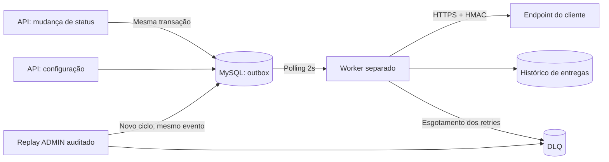

# RFC — Sistema de Webhooks de Notificação de Pedidos

## Metadados

| Campo | Valor |
| --- | --- |
| ID | RFC-001 |
| Autor | Documentação assistida por IA, baseada na reunião técnica do OMS |
| Status | Em revisão; decisões centrais aceitas na reunião, detalhes derivados propostos no FDD |
| Data | 2026-10-21 |
| Revisores | Larissa (Tech Lead), Marcos (PM), Bruno (Engenharia de Pedidos), Diego (Plataforma), Sofia (Segurança) |
| Prazo | Três sprints, incluindo dois dias úteis de revisão de segurança; solicitação comercial até fim de novembro (`[09:45] Marcos`, `[09:46] Larissa`, `[09:46] Sofia`) |

## Resumo Executivo (TL;DR)

Propomos notificar clientes B2B sobre mudanças de status por outbound webhooks. O evento será gravado numa outbox no MySQL, na mesma transação do pedido, e enviado por worker separado em polling de 2s. A solução usa HMAC-SHA256 por endpoint, cinco intervalos de retry, DLQ com replay ADMIN e UUID para deduplicação (`[09:48] Larissa`). A meta é notificação abaixo de 10s em condições normais (`[09:02] Marcos`); fila, rede e falhas também precisam ser medidos.

O [FDD](./FDD.md) concentra schema, algoritmos, payloads, headers e códigos de erro. Este RFC apresenta a arquitetura, os trade-offs e os pontos submetidos à revisão.

## Contexto e Problema

Atlas Comercial, MaxDistribuição e Nova Cargo consultam repetidamente pedidos para descobrir mudanças de status. A integração é lenta e cara, e a Atlas sinalizou risco de migração para a concorrência até o fim do trimestre (`[09:00] Marcos`).

O método `OrderService.changeStatus`, em `src/modules/orders/order.service.ts`, já altera pedido, estoque e histórico numa transação. A notificação não pode depender de uma chamada HTTP dentro dessa transação nem perder o evento após o commit (`[09:04] Bruno`, `[09:06] Diego`). A proposta aproveita MySQL/Prisma, Zod, autenticação e Pino existentes.

## Proposta Técnica

1. **Outbox transacional (`RFC-PROP-01`)**: inserir eventos somente para endpoints ativos interessados no status, usando UUID e snapshot JSON renderizado na inserção. A função `publishWebhookEvent(tx, ...)` recebe a transação existente; falha de inserção reverte a mudança de status (`[09:34] Bruno`, `[09:40] Bruno`, `[09:41] Bruno`, `[09:51] Larissa`, `[09:52] Larissa`).
2. **Worker separado (`RFC-PROP-02`)**: processo Node.js com PrismaClient próprio, polling de 2s e instância única na v1. A reunião prevê ordem por pedido; as condições para preservar essa ordem durante retries e empates estão propostas no FDD, sem introduzir escala multi-worker (`[09:09] Diego`, `[09:11] Diego`, `[09:12] Diego`, `[09:30] Bruno`).
3. **Retry e DLQ (`RFC-PROP-03`)**: timeout de 10s e esperas de 1m/5m/30m/2h/12h. O FDD interpreta a contagem como envio inicial + cinco retentativas, preservando a janela de quase 15h. Esgotado o ciclo, persiste DLQ com replay manual ADMIN e auditoria (`[09:17] Diego`, `[09:18] Diego`, `[09:36] Sofia`, `[09:42] Diego`).
4. **Segurança (`RFC-PROP-04`)**: HTTPS obrigatório, limite de 64KB, HMAC-SHA256 sobre o corpo e secret exclusiva por endpoint. Rotação mantém a chave anterior válida por 24h. O FDD propõe um formato único de assinatura nessa janela e trata rotações sobrepostas (`[09:20] Sofia`, `[09:21] Sofia`, `[09:23] Sofia`, `[09:24] Larissa`).
5. **At-least-once (`RFC-PROP-05`)**: retries e replay preservam `X-Event-Id`; o receptor deduplica pelo UUID. Entrega depende da recuperação do receptor e, após DLQ, de intervenção administrativa; não se promete sucesso para endpoint permanentemente indisponível (`[09:24] Diego`, `[09:25] Diego`, `[09:26] Marcos`).
6. **Reuso do OMS (`RFC-PROP-06`)**: módulo de webhooks segue os padrões de `src/modules`, AppError, Zod, autenticação e Pino. A integração respeita as assinaturas reais dos componentes; os detalhes ficam no FDD (`[09:27] Bruno`, `[09:28] Bruno`, `[09:29] Bruno`, `[09:30] Larissa`).

## Alternativas Consideradas

A tabela distingue as alternativas discutidas da análise técnica derivada de suas consequências.

| ID | Alternativa | Trade-off e motivo do descarte |
| --- | --- | --- |
| `RFC-ALT-01` | HTTP síncrono na mudança de status | Simplicidade versus bloqueio da transação e dependência do servidor do cliente. Descartado para não travar pedidos nem exigir rollback por indisponibilidade externa (`[09:04] Bruno`). |
| `RFC-ALT-02` | Redis Streams/Cluster | Broker dedicado versus infraestrutura e operação adicionais para equipe pequena. MySQL existente foi considerado suficiente (`[09:07] Larissa`, `[09:07] Diego`). |
| `RFC-ALT-03` | Trigger para notificação ou worker dentro da API | Reatividade/processo único versus integração frágil e ciclo de vida acoplado. Trigger não notifica processo externo como LISTEN/NOTIFY; reiniciar a API interromperia o worker embutido (`[09:09] Diego`, `[09:11] Diego`). |
| `RFC-ALT-04` | Três retries ou retry indefinido | Descarte rápido versus tolerância a manutenção; retries infinitos acumulam eventos abandonados. Três tentativas em cerca de 30m não cobrem manutenções históricas de 2h (`[09:15] Diego`, `[09:16] Bruno`, `[09:16] Diego`). |
| `RFC-ALT-05` | Secret global | Facilidade operacional versus comprometimento de todos os endpoints por um vazamento. A reunião exige secret por endpoint; o risco de rotação sem transição é análise derivada do grace period exigido (`[09:21] Sofia`). |
| `RFC-ALT-06` | Exactly-once | Deduplicação transparente versus coordenação bilateral complexa. A equipe preferiu at-least-once com deduplicação no receptor (`[09:25] Diego`). |

## Questões em Aberto

Os seguintes assuntos foram adiados na reunião e não integram a implementação desta v1:

1. **Rate limiting de saída (`RFC-OPEN-01`)**: observar o volume real e decidir depois se é necessário limitar chamadas por cliente (`[09:38] Diego`, `[09:39] Larissa`).
2. **Multi-worker (`RFC-OPEN-02`)**: particionamento por pedido ou lock pessimista são evoluções futuras; manter instância única nesta fase (`[09:13] Diego`, `[09:13] Larissa`).
3. **Alertas por e-mail (`RFC-OPEN-03`)**: medir o impacto antes de uma fase posterior (`[09:37] Larissa`).
4. **Expurgo/arquivamento (`RFC-OPEN-04`)**: limpeza após cerca de 30 dias fica fora da feature (`[09:08] Diego`).
5. **RBAC granular no CRUD (`RFC-OPEN-05`)**: qualquer role autenticada pode gerenciar configurações nesta fase; replay já exige ADMIN (`[09:36] Marcos`, `[09:37] Sofia`).

### Detalhamento Derivado para Revisão (`RFC-REVIEW-01`)

A equipe deve avaliar `FDD-DET-01` a `FDD-DET-08`: contagem explícita dos retries, recuperação após crash, ciclos de DLQ, ordenação sob retry, formato de assinatura/rotações sucessivas, adaptação de erros, métricas e modelagem/contratos. Cada proposta tem fundamento e justificativa no FDD. **Não são decisões adicionais já aprovadas na reunião.** O desenho está pronto para revisão técnica, conforme a sessão prevista por Larissa (`[09:50] Larissa`).

## Impacto e Riscos

| ID | Risco e mitigação proposta |
| --- | --- |
| `RFC-RISK-01` | Escritas adicionais na transação de pedidos: filtrar assinaturas na inserção e manter I/O externo no worker (`[09:34] Bruno`, `[09:40] Bruno`). |
| `RFC-RISK-02` | Crescimento do armazenamento: índices, payload enxuto e DLQ dedicada mantêm o caminho de polling delimitado; expurgo permanece futuro (`[09:08] Diego`, `[09:18] Diego`, `[09:43] Diego`). |
| `RFC-RISK-03` | Vazamento ou erro em HMAC/secrets: redaction proposto no Pino, rotação e revisão de segurança antes do deploy (`[09:22] Diego`, `[09:46] Sofia`). |
| `RFC-RISK-04` | Ordem e capacidade: uma instância evita concorrência entre workers, mas a seleção com predecessor também é necessária. Retry/DLQ bloqueiam sucessores e podem superar a meta de 10s; medir fila e confirmação de entrega, sem confundir com duração HTTP (`[09:12] Diego`, `[09:13] Larissa`; detalhamento derivado no FDD). |

## Decisões Relacionadas

- [ADR-001 — Outbox no MySQL](./adrs/ADR-001-outbox-no-mysql.md)
- [ADR-002 — Worker separado em polling](./adrs/ADR-002-worker-separado-em-polling.md)
- [ADR-003 — Retry e DLQ](./adrs/ADR-003-politica-de-retry-backoff-e-dlq.md)
- [ADR-004 — HMAC e rotação de secret](./adrs/ADR-004-autenticacao-hmac-sha256-e-rotacao-de-secret.md)
- [ADR-005 — At-least-once e X-Event-Id](./adrs/ADR-005-entrega-at-least-once-com-x-event-id.md)
- [ADR-006 — Reuso dos padrões do OMS](./adrs/ADR-006-reuso-dos-padroes-existentes-do-oms.md)
